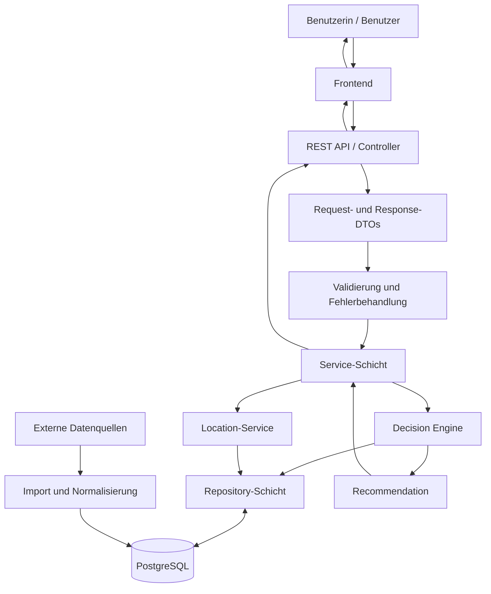

# WoHinDamit – Systemarchitektur

**Status:** Zielarchitektur für die Teamabstimmung
**Projektphase:** Phase 1 – Analyse und Basisdesign
**Stand:** Oktober 2026

## 1. Ziel

WoHinDamit wird als Client-Server-Webanwendung umgesetzt. Die Anwendung unterstützt Benutzerinnen und Benutzer dabei, geeignete Entscheidungen für nicht mehr benötigte oder beschädigte Gegenstände zu treffen und passende Standorte zu finden.

Die Architektur trennt Benutzeroberfläche, API, Geschäftslogik, Datenzugriff und externe Datenquellen voneinander.

Die wichtigsten Ziele sind:

- klare Trennung der Verantwortlichkeiten;
- wartbarer und erweiterbarer Code;
- datenbankgestützte Entscheidungsregeln;
- dokumentierte Schnittstellen zwischen Frontend und Backend;
- nachvollziehbare Herkunft und Aktualität externer Standortdaten;
- zentrale Validierung und Fehlerbehandlung;
- automatisierte Tests für die wesentlichen Funktionen.

Dieses Dokument beschreibt die Zielarchitektur. Es unterscheidet zwischen bereits vorhandenen Prototyp-Komponenten und noch geplanten Funktionen.

## 2. Gesamtarchitektur



Die Darstellung beschreibt den vorgesehenen logischen Aufbau. Sie bedeutet nicht, dass alle Komponenten bereits implementiert sind.

## 3. Architekturkomponenten und Verantwortlichkeiten

| Komponente | Verantwortung |
|---|---|
| Frontend | Kategorien und Gegenstände anzeigen, Fragen und Antwortoptionen darstellen, Antworten erfassen, Empfehlungen und Standorte präsentieren. |
| REST API / Controller | HTTP-Anfragen entgegennehmen, Request- und Response-DTOs verwenden und geeignete Statuscodes zurückgeben. |
| Validierung und Fehlerbehandlung | Ungültige Eingaben erkennen, Fehler einheitlich behandeln und verständliche Fehlermeldungen bereitstellen. |
| Service-Schicht | Anwendungsfälle koordinieren und die Zusammenarbeit zwischen Repositorys, Entscheidungslogik und weiteren Services steuern. |
| Decision Engine | Antworten validieren, aktive Regeln laden, Bedingungen auswerten und die passende Empfehlung bestimmen. |
| Repository-Schicht | Datenbankabfragen und den Zugriff auf persistente Daten kapseln. |
| PostgreSQL | Strukturierte Projektdaten wie Kategorien, Gegenstände, Fragen, Antwortoptionen, Regeln, Empfehlungen und Standorte speichern. |
| Data Import | Externe Standortdaten laden, validieren, normalisieren und den Importstatus dokumentieren. |
| Location-Service | Standortdaten für die API bereitstellen und später geeignete Standorte anhand vereinbarter Filter bestimmen. |
| Externe Datenquellen | Offizielle Open-Data-Datensätze und überprüfte Anbieterinformationen bereitstellen. |

## 4. Frontend

Das Frontend ist für die Benutzeroberfläche und die Interaktion mit den Benutzerinnen und Benutzern verantwortlich.

Die Aufgaben umfassen:

- Gegenstände suchen und Kategorien auswählen;
- Fragen und Antwortmöglichkeiten anzeigen;
- Antworten erfassen und an das Backend senden;
- Empfehlungen und deren Begründungen anzeigen;
- passende Standorte auflisten und auf einer Karte darstellen;
- verfügbare Adressen und Kontaktinformationen anzeigen;
- verständliche Meldungen bei Fehlern oder fehlenden Daten darstellen.

Die fachliche Entscheidungslogik liegt im Backend. Das Frontend soll keine eigenen, vom Backend abweichenden Entscheidungsregeln enthalten.

## 5. REST API / Controller

Die API bildet die Schnittstelle zwischen Frontend und Backend.

Sie übernimmt folgende Aufgaben:

- HTTP-Anfragen entgegennehmen;
- Requests und Responses über DTOs definieren;
- Eingaben an die Validierung und Service-Schicht übergeben;
- HTTP-Statuscodes und JSON-Antworten zurückgeben;
- Fehler kontrolliert behandeln.

Controller sollen möglichst wenig Geschäftslogik enthalten. Komplexe Regeln und Anwendungsabläufe gehören in die Service-Schicht.

Die aktuellen und geplanten API-Routen sind in `docs/api.md` dokumentiert.

## 6. Service-Schicht

Die Service-Schicht koordiniert die Anwendungsfälle.

Zu den Aufgaben gehören:

- Daten über Repositorys abrufen;
- Kategorien, Fragen und Antwortoptionen für die API bereitstellen;
- die Entscheidungslogik aufrufen;
- Eingaben gemäß den fachlichen Anforderungen validieren;
- später externe Standortdaten und Standortabfragen koordinieren.

Die Services bilden die Verbindung zwischen Controllern, Repositorys und fachlichen Komponenten. Controller sollen nicht direkt auf die Datenbank zugreifen.

## 7. Decision Engine

Die Entscheidungslogik ist ein zentraler Bestandteil von WoHinDamit.

Die Regeln sollen grundsätzlich in der Datenbank gepflegt werden. Fachliche Aktionen dürfen nicht für jede Kategorie als fest codierte Sonderfälle im Java-Code hinterlegt werden.

Der vorgesehene Ablauf ist:

```text
Gegenstand und Kategorie auswählen
              |
              v
Aktive Fragen und Antwortoptionen laden
              |
              v
Antworten erfassen
              |
              v
Antworten validieren
              |
              v
Aktive Regeln aus der Datenbank laden
              |
              v
Kategorie- und Gegenstandsbezug prüfen
              |
              v
Regelbedingungen auswerten
              |
              v
Passende Regel nach vereinbarter Priorität auswählen
              |
              v
Recommendation und Begründung zurückgeben
```

Die Bedingungen einer Regel werden anhand stabiler Fragecodes ausgewertet, beispielsweise `repairable` oder `functional`. Fragetexte sollen nicht als technische Schlüssel verwendet werden, da sie sich ändern oder übersetzt werden können.

Die Prioritätskonvention muss im Team eindeutig festgelegt werden. Der aktuelle Prototyp behandelt einen höheren numerischen Prioritätswert als höhere Priorität. Diese Konvention ist mit der fachlichen Spezifikation abzugleichen.

Falls keine Regel passt, muss die API einen dokumentierten und mit dem Frontend abgestimmten Rückgabefall liefern.

## 8. Datenbank

PostgreSQL ist die zentrale persistente Datenquelle.

Die Datenbank soll mindestens folgende fachliche Bereiche unterstützen:

| Entity | Zweck |
|---|---|
| `Category` | Kategorien und gegebenenfalls hierarchische Beziehungen abbilden. |
| `Item` | Gegenstände speichern und Kategorien zuordnen. |
| `Question` | Fragen einer Kategorie oder eines Gegenstands beschreiben. |
| `AnswerOption` | Zulässige Antwortoptionen einer Frage speichern. |
| `Rule` | Bedingungen, Prioritäten und Begründungen von Entscheidungsregeln speichern. |
| `Recommendation` | Mögliche Aktionen und zugehörige Empfehlungstexte definieren. |
| `LocationType` | Standortarten wie Sammelstelle oder Reparaturwerkstatt definieren. |
| `Location` | Standortinformationen und Quellenmetadaten speichern. |

Die endgültigen Tabellen, Attribute, Pflichtfelder, Fremdschlüssel und Kardinalitäten werden in `docs/database.md` und dem ER-Diagramm festgelegt.

Die Datenbankstruktur soll Änderungen an Regeln und Empfehlungen ermöglichen, ohne bei jeder fachlichen Anpassung den Java-Code ändern zu müssen.

## 9. Externe Datenquellen und Datenimport

Externe Datenquellen werden nicht direkt vom Frontend abgefragt. Der Zugriff erfolgt über das Backend beziehungsweise über einen kontrollierten Importprozess.

Der vorgesehene Ablauf lautet:

```text
Externe Datenquelle
        |
        v
Datenabruf / Import
        |
        v
Validierung und Normalisierung
        |
        v
Zuordnung zur internen Datenstruktur
        |
        v
Speicherung in PostgreSQL
        |
        v
Location-Service / REST API
        |
        v
Frontend
```

Mögliche Quellen sind:

- Open Data der Stadt Wien;
- Daten zu MA-48-Einrichtungen und Mistplätzen;
- Altstoffsammel- und Problemstoffsammelstellen;
- geprüfte Informationen zu Reparaturwerkstätten und Repair-Cafés;
- weitere geeignete Weitergabestellen und Gebrauchtwarenangebote.

Für jede Quelle müssen Datenformat, Nutzungsbedingungen, Aktualisierungsrhythmus, verfügbare Felder und bekannte Datenlücken dokumentiert werden.

Externe Daten sollen nachvollziehbar einer Quelle zugeordnet werden können. Die Aktualisierungsstrategie darf vorhandene Daten nicht unbemerkt überschreiben.

Fehlende Informationen wie Telefonnummern, E-Mail-Adressen oder Öffnungszeiten werden nicht erfunden. Nicht verfügbare Werte werden gemäß dem festgelegten Datenmodell als fehlend gespeichert oder über die API entsprechend dargestellt.

## 10. Standortdaten und Location-Service

Der Location-Service stellt Standortinformationen für das Frontend bereit.

Ein Standort kann – abhängig von der Datenquelle – folgende Informationen enthalten:

- Name;
- Standorttyp;
- Adresse und Postleitzahl;
- geografische Koordinaten;
- Bezirk;
- Telefonnummer und E-Mail-Adresse;
- Website und Öffnungszeiten;
- Datenquelle und externe Referenz;
- Zeitpunkt der letzten Aktualisierung.

Geplante Funktionen sind:

- Standorte nach Typ filtern;
- Standorte nach Kategorie oder Bezirk filtern;
- Standorte innerhalb eines Suchradius bestimmen;
- geeignete Standorte für eine Empfehlung anzeigen.

Die endgültigen Filter, Sortierregeln und Anforderungen an die Standortsuche werden vor der Implementierung festgelegt.

## 11. Layering und Paketstruktur im Java-Projekt

Die Java-Anwendung verwendet eine schichtorientierte Struktur.

Empfohlene Paketverantwortungen:

| Package | Verantwortung |
|---|---|
| `controller` | REST-Endpunkte und HTTP-Verarbeitung |
| `dto` | Öffentliche Request- und Response-Formate |
| `service` | Anwendungsfälle, Validierung und Geschäftslogik |
| `entity` | Persistente Datenmodelle |
| `repository` | Datenbankabfragen |
| `exception` | Zentrale Fehlerbehandlung |
| später `importer` oder `integration` | Externe Datenquellen und Importprozesse |

Die Trennung sorgt dafür, dass Änderungen an der API, der Entscheidungslogik oder den Datenquellen möglichst wenig Auswirkungen auf andere Schichten haben.

## 12. Sicherheit

Die Architektur berücksichtigt grundlegende Sicherheitsmaßnahmen:

- Eingaben serverseitig validieren;
- keine direkte Datenbankverbindung vom Frontend zulassen;
- sensible Zugangsdaten nicht im Repository speichern;
- Datenbankzugänge über geeignete Konfiguration bereitstellen;
- interne technische Informationen nicht an Benutzerinnen und Benutzer weitergeben;
- Import- und Verwaltungsfunktionen nicht ungeschützt öffentlich anbieten;
- zulässige Request-Größen und Eingabeformate begrenzen.

Authentifizierung, Autorisierung und administrative Zugriffe müssen entsprechend den tatsächlichen Projektanforderungen festgelegt werden.

## 13. Fehlerbehandlung und Verfügbarkeit

Fehler werden möglichst innerhalb der zuständigen Schicht erkannt und kontrolliert weitergegeben.

| Bereich | Verhalten |
|---|---|
| Frontend | Verständliche Meldungen anzeigen und fehlende Informationen kenntlich machen. |
| Controller / API | Geeignete HTTP-Statuscodes und dokumentierte Fehlerantworten liefern. |
| Service / Decision Engine | Ungültige Eingaben und fachliche Sonderfälle kontrolliert behandeln. |
| Datenbank | Datenbankfehler erkennen und Anfragen kontrolliert beenden. |
| Externe Datenquelle | Fehler protokollieren und – sofern fachlich vertretbar – vorhandene gespeicherte Daten weiterverwenden. |
| Datenimport | Importstatus und Fehler nachvollziehbar dokumentieren. |

Fehlermeldungen dürfen keine Stacktraces, Zugangsdaten oder sonstigen internen technischen Details offenlegen.

Das konkrete Fehlerformat wird in `docs/errors.md` und `docs/api.md` festgelegt.

## 14. Tests und Qualitätssicherung

Die Architektur soll automatisierte Tests auf mehreren Ebenen unterstützen.

**Unit-Tests:**

- Validierung der Antworten;
- Auswertung der Regelbedingungen;
- Prioritätsauswahl;
- Erzeugung der Empfehlung;
- Verhalten bei ungültigen oder fehlenden Eingaben.

**Controller-Tests:**

- HTTP-Statuscodes;
- Response-Formate;
- Eingabevalidierung;
- Fehlerbehandlung;
- Verhalten bei fehlenden Ressourcen.

**Integrationstests:**

- Verbindung zur Datenbank;
- Repository-Abfragen;
- Zusammenspiel von Service, Repository und Datenbank;
- Verhalten des Gesamtsystems mit realistischen Testdaten.

Externe Datenimporte benötigen eigene Tests für Normalisierung, fehlerhafte Datensätze und fehlende Felder.

## 15. Verantwortlichkeiten im Team

### Backend – Noushin Azimi

Verantwortlich für:

- Backend und Datenbank;
- Entscheidungslogik;
- dokumentierte Backend-Schnittstellen;
- externe Datenquellen und Datenimport;
- Validierung und Fehlerbehandlung;
- Backend-Tests;
- technische Dokumentation.

### Frontend – Mohamad Rastegar Moghadam

Verantwortlich für:

- Benutzeroberfläche;
- Such- und Entscheidungsablauf im Frontend;
- Kartenansicht und Darstellung von Standorten;
- Anzeige von Empfehlungen und Kontaktinformationen;
- Frontend-Backend-Integration;
- Deployment sowie Server- und Netzwerkdokumentation gemäß der Teamvereinbarung.

Beide Teammitglieder stimmen API-Verträge, Integration, Tests und Projektdokumentation gemeinsam ab.

## 16. Erweiterbarkeit

Die Architektur soll spätere optionale Funktionen ermöglichen, ohne den Kern des Systems grundlegend neu zu gestalten.

Mögliche Erweiterungen sind:

- Beiträge und Weitergabe-Angebote;
- Foto-Upload und Bilderkennung;
- Favoriten;
- Routenplanung;
- Prüfung von Öffnungszeiten;
- Verwaltungsfunktionen;
- zusätzliche Wissens- und Informationsangebote.

Diese Funktionen werden erst eingeplant, wenn sie durch den Projektumfang bestätigt sind.

## 17. Aktueller Prototyp und Zielzustand

Der aktuelle Prototyp enthält bereits:

- Spring Boot und PostgreSQL;
- JPA-Entities und Repositorys;
- Service-Klassen;
- eine erste datenbankgestützte Entscheidungslogik;
- DTOs für Anfragen und Antworten;
- Endpunkte für Kategorien, Fragen und Antwortoptionen;
- einen Endpunkt zur Entscheidungsauswertung;
- eine zentrale Behandlung bestimmter Eingabefehler;
- automatisierte Tests für wesentliche Service- und Controller-Funktionen.

Die Standort-API und die externe Importpipeline sind noch als geplante Implementierungsarbeit zu behandeln.

Die vorhandenen Komponenten werden im Rahmen eines Code-Reviews mit der endgültigen fachlichen Architektur, dem Datenmodell und dem API-Vertrag abgeglichen.

Ein erfolgreicher Testlauf des Prototyps bestätigt noch nicht, dass alle fachlichen Anforderungen, Datenquellen oder Integrationsanforderungen erfüllt sind.

## 18. Architekturprinzip

Die grundlegende Verantwortungsverteilung lautet:

```text
Presentation
     |
     v
REST API / Controller
     |
     v
Service-Schicht
     |
     v
Business Logic / Decision Engine
     |
     v
Repository-Schicht
     |
     v
PostgreSQL
```

Für externe Standortdaten gilt ergänzend:

```text
Externe Datenquelle
        |
        v
Import und Normalisierung
        |
        v
PostgreSQL
        |
        v
Location-Service
        |
        v
REST API
        |
        v
Frontend
```

Die Architektur folgt dem Prinzip einer klaren Trennung der Verantwortlichkeiten. Entscheidungen, persistente Daten und externe Datenimporte sollen nachvollziehbar, testbar und unabhängig voneinander weiterentwickelt werden können.

## 19. Offene Architekturentscheidungen

Vor dem Übergang zur umfangreicheren Backend-Implementierung sind insbesondere folgende Punkte zu klären:

1. Endgültige ER-Struktur und Beziehungen der Datenbank-Entities.
2. Fachliche Konvention für Rule-Prioritäten und das Verhalten bei keiner passenden Regel.
3. Verbindlicher API-Vertrag mit dem Frontend-Team.
4. Verantwortlichkeit und Aktualisierungsstrategie für externe Standortdaten.
5. Erforderliche Sicherheitsmaßnahmen für administrative und interne Funktionen.
6. Anforderungen an Standortsuche, Umkreisfilter und Kartenintegration.
7. Umgang mit fehlenden, veralteten oder widersprüchlichen externen Daten.

Diese Entscheidungen werden in den zugehörigen Dokumenten festgehalten und gemeinsam abgestimmt.

**Fazit:** Die Architektur definiert die vorgesehene technische Struktur von WoHinDamit. Der bestehende Prototyp bildet eine erste technische Grundlage; die vollständige Umsetzung erfolgt schrittweise auf Basis der abgestimmten Requirements, des Datenmodells und des API-Designs.
