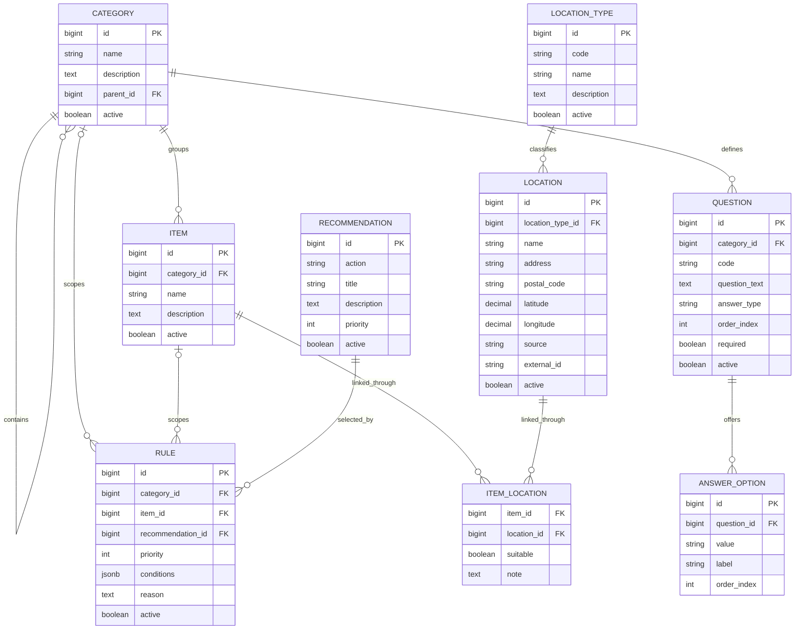

# WoHinDamit – Datenbankdesign

**Status:** Logischer Datenbankentwurf für die Teamabstimmung
**Projektphase:** Phase 1 – Analyse und Basisdesign
**Stand:** Oktober 2026
**Datenbankmanagementsystem:** PostgreSQL

## 1. Ziel

Die Datenbank bildet die zentrale Datenbasis der Anwendung WoHinDamit.

Sie speichert insbesondere:

- Kategorien und Gegenstände;
- Fragen und Antwortoptionen;
- Entscheidungsregeln;
- Empfehlungen;
- Standorttypen und Standorte;
- Zuordnungen zwischen Gegenständen und geeigneten Standorten;
- Informationen zur Herkunft und Aktualisierung externer Daten.

Das Datenmodell soll erweiterbar, nachvollziehbar und wartbar bleiben. Neue Kategorien, Fragen, Regeln und Standorttypen sollen möglichst ohne grundlegende Änderungen an der Anwendungslogik ergänzt werden können.

Dieses Dokument beschreibt den logischen Zielentwurf. Vor der endgültigen Umsetzung werden die Attribute und Beziehungen mit dem aktuellen PostgreSQL-Schema, den Java-Entities und den fachlichen Anforderungen abgeglichen.

## 2. Technische Grundentscheidungen

### 2.1 Datenbank und IDs

PostgreSQL wird als Datenbankmanagementsystem verwendet.

Für Primärschlüssel ist im aktuellen Prototyp folgende Konvention vorgesehen:

- Java: `Long`
- PostgreSQL: `BIGINT`
- automatische ID-Generierung durch die Datenbank

Jede Tabelle besitzt einen eindeutigen Primärschlüssel. Beziehungen zwischen Tabellen werden über Fremdschlüssel abgebildet.

### 2.2 Datentypen

Die folgenden Datentypen dienen als logische Empfehlung:

| Anwendungsfall | Empfohlener Typ |
|---|---|
| Primär- und Fremdschlüssel | `BIGINT` |
| Namen und kurze Texte | `VARCHAR` |
| Beschreibungen und Fragetexte | `TEXT` |
| Aktivstatus und Pflichtfelder | `BOOLEAN` |
| Reihenfolge und Priorität | `INTEGER` |
| Entscheidungsbedingungen | `JSONB` |
| Koordinaten | numerische Werte mit geeigneter Genauigkeit |
| Zeitstempel | `TIMESTAMP WITH TIME ZONE`, sofern ein eindeutiger Zeitpunkt benötigt wird |

Die konkreten Datentypen müssen bei der Umsetzung mit den JPA-Entities und der bestehenden Datenbank abgestimmt werden.

### 2.3 Aktivstatus

Fachliche Datensätze, die vorübergehend nicht verwendet werden sollen, können über ein Feld wie `active` deaktiviert werden.

Inaktive Datensätze sollen bei den entsprechenden öffentlichen API-Abfragen und bei der Regelauswertung nicht berücksichtigt werden.

### 2.4 Fehlende Daten

Nicht verfügbare Informationen werden nicht erfunden.

Optionale Informationen wie Telefonnummer, E-Mail-Adresse, Website oder Öffnungszeiten dürfen fehlen. Nicht bekannte Werte werden als `NULL` gespeichert, sofern das jeweilige Feld optional ist.

## 3. Überblick über die Kern-Entities

Das Datenmodell umfasst folgende Hauptentitäten:

| Entity | Aufgabe |
|---|---|
| `Category` | Gruppiert ähnliche Gegenstände und kann eine Hierarchie bilden. |
| `Item` | Beschreibt einen Gegenstand und ordnet ihn einer Kategorie zu. |
| `Question` | Definiert eine Frage für eine Kategorie. |
| `AnswerOption` | Speichert auswählbare Antworten einer Frage. |
| `Rule` | Definiert Bedingungen und die zugehörige Empfehlung. |
| `Recommendation` | Beschreibt eine mögliche Handlung. |
| `LocationType` | Definiert einen Standorttyp. |
| `Location` | Speichert einen konkreten Standort inklusive Quelleninformationen. |
| `ItemLocation` | Ordnet Gegenstände geeigneten Standorten zu. |

Die Zuordnung `ItemLocation` wird benötigt, wenn verschiedene Gegenstände oder Materialgruppen unterschiedliche Standorte benötigen.

## 4. Entity: Category

Eine Kategorie gruppiert ähnliche Gegenstände. Kategorien können beispielsweise hierarchisch organisiert werden.

**Beispiele:**

- Elektrogeräte
- Möbel
- Kleidung
- Fahrräder
- Fahrzeuge

### Felder

| Feld | Typ | Beschreibung |
|---|---|---|
| `id` | `BIGINT` | Primärschlüssel |
| `name` | `VARCHAR` | Name der Kategorie |
| `description` | `TEXT`, optional | Beschreibung |
| `parent_id` | `BIGINT`, optional | Referenz auf die übergeordnete Kategorie |
| `active` | `BOOLEAN` | Aktiv- oder Inaktivstatus |

### Beziehungen

- Eine Kategorie kann mehrere Unterkategorien besitzen.
- Eine Kategorie kann mehrere Gegenstände enthalten.
- Eine Kategorie kann mehrere Fragen besitzen.
- Eine Kategorie kann mehreren Entscheidungsregeln zugeordnet sein.

**Beziehungsmodell:**

- `Category 1:N Category` (Parent/Child)
- `Category 1:N Item`
- `Category 1:N Question`
- `Category 1:N Rule`

Die Referenz `parent_id` verweist auf `categories.id`. Eine Kategorie ohne übergeordnete Kategorie hat `parent_id = NULL`.

## 5. Entity: Item

Ein Item beschreibt einen Gegenstand, für den eine Empfehlung ermittelt werden kann.

**Beispiele:**

- Fahrrad
- Laptop
- Kühlschrank
- Waschmaschine
- Sofa

### Felder

| Feld | Typ | Beschreibung |
|---|---|---|
| `id` | `BIGINT` | Primärschlüssel |
| `category_id` | `BIGINT` | Zugehörige Kategorie |
| `name` | `VARCHAR` | Name des Gegenstands |
| `description` | `TEXT`, optional | Beschreibung |
| `active` | `BOOLEAN` | Aktiv- oder Inaktivstatus |

### Beziehungen

Ein Item gehört zu genau einer Hauptkategorie.

- `Category 1:N Item`
- `Item 1:N Rule`
- `Item N:M Location` über `ItemLocation`

Der Gegenstandsbezug einer Regel kann optional sein. Eine allgemeine Regel kann beispielsweise für eine Kategorie gelten, während eine spezielle Regel nur für ein bestimmtes Item gilt.

Ob jeder Entscheidungsrequest zwingend eine `item_id` benötigt, wird im API-Design festgelegt.

## 6. Entity: Question

Eine Question beschreibt eine Frage zu Zustand oder Eigenschaften eines Gegenstands.

**Beispiele:**

- Ist der Gegenstand noch funktionsfähig?
- Ist der Gegenstand reparierbar?
- Ist der Gegenstand vollständig?
- Ist der Gegenstand noch verwendbar?

### Felder

| Feld | Typ | Beschreibung |
|---|---|---|
| `id` | `BIGINT` | Primärschlüssel |
| `category_id` | `BIGINT` | Kategorie, für die die Frage gilt |
| `code` | `VARCHAR(100)` | Stabiler technischer Schlüssel |
| `question_text` | `TEXT` | Anzuzeigender Fragetext |
| `answer_type` | `VARCHAR` | Typ der erwarteten Antwort |
| `order_index` | `INTEGER` | Anzeigereihenfolge |
| `required` | `BOOLEAN` | Gibt an, ob eine Antwort erforderlich ist |
| `active` | `BOOLEAN` | Aktiv- oder Inaktivstatus |

### Beziehungen

- `Category 1:N Question`
- `Question 1:N AnswerOption`

### Constraints

Die Kombination aus Kategorie und Fragecode muss eindeutig sein:

`UNIQUE(category_id, code)`

Beispiel:

`repairable`

Der technische Fragecode dient als Schlüssel in der Entscheidungslogik. Der Fragetext darf geändert oder übersetzt werden, ohne die Regelreferenz zu verändern.

Im aktuellen Prototyp sind Fragen Kategorien zugeordnet. Ob später zusätzlich eine direkte Zuordnung zwischen Fragen und einzelnen Gegenständen benötigt wird, ist fachlich zu prüfen.

## 7. Entity: AnswerOption

Eine AnswerOption beschreibt eine auswählbare Antwort auf eine Frage.

**Beispiele:**

- Ja
- Nein
- Teilweise
- Unbekannt

### Felder

| Feld | Typ | Beschreibung |
|---|---|---|
| `id` | `BIGINT` | Primärschlüssel |
| `question_id` | `BIGINT` | Zugehörige Frage |
| `value` | `VARCHAR` | Maschinenlesbarer Wert |
| `label` | `VARCHAR` | Angezeigte Beschriftung |
| `order_index` | `INTEGER` | Anzeigereihenfolge |

### Beziehung

`Question 1:N AnswerOption`

### Constraints

Als zusätzliche Integritätsregel wird empfohlen:

`UNIQUE(question_id, value)`

Damit kann derselbe interne Antwortwert nicht mehrfach für dieselbe Frage angelegt werden.

`value` und `label` haben unterschiedliche Aufgaben. Das Frontend zeigt `label` an; die Entscheidungslogik verwendet `value`.

Bei Boolean-Fragen können beispielsweise `true` und `false` als Werte verwendet werden. Bei Auswahlfragen werden nur Werte akzeptiert, die für die jeweilige Frage konfiguriert wurden.

Der zusätzliche Unique-Constraint ist vor der endgültigen Migration zu prüfen und gegebenenfalls zu ergänzen.

## 8. Entity: Recommendation

Eine Recommendation beschreibt eine mögliche Handlungsempfehlung.

### Mögliche Aktionen

- `REPAIR`
- `SELL`
- `GIVE_AWAY`
- `DONATE`
- `RECYCLE`
- `DISPOSE`

Die endgültige Liste muss mit den fachlichen Projektanforderungen abgestimmt werden.

### Felder

| Feld | Typ | Beschreibung |
|---|---|---|
| `id` | `BIGINT` | Primärschlüssel |
| `action` | `VARCHAR` oder Enum | Fachliche Handlung |
| `title` | `VARCHAR` | Titel der Empfehlung |
| `description` | `TEXT`, optional | Beschreibung |
| `priority` | `INTEGER`, optional | Priorität der Empfehlung, falls fachlich erforderlich |
| `active` | `BOOLEAN` | Aktiv- oder Inaktivstatus |

### Beziehung

`Recommendation 1:N Rule`

Eine Empfehlung kann mit mehreren Regeln verbunden sein.

**Wichtig:** Die Priorität einer Regel und eine mögliche Priorität einer Empfehlung sind unterschiedliche Konzepte.

- `Rule.priority` entscheidet, welche passende Regel ausgewählt wird.
- `Recommendation.priority` ist nur erforderlich, wenn die Empfehlung selbst eine separate fachliche Priorität besitzt.

Im aktuellen Prototyp wird die passende Regel anhand ihrer numerischen Priorität ausgewählt. Eine Empfehlungspriorität ist nicht Teil der aktuellen Decision-API-Antwort.

## 9. Entity: Rule

Eine Rule definiert die Bedingungen, unter denen eine bestimmte Empfehlung ausgewählt wird.

Die Entscheidungsregeln sind ein zentraler Bestandteil des Systems. Sie sollen in der Datenbank gepflegt werden können und nicht für jede Kategorie fest im Java-Code hinterlegt sein.

### Felder

| Feld | Typ | Beschreibung |
|---|---|---|
| `id` | `BIGINT` | Primärschlüssel |
| `category_id` | `BIGINT`, optional | Kategoriebezug |
| `item_id` | `BIGINT`, optional | Optionaler Bezug zu einem konkreten Gegenstand |
| `recommendation_id` | `BIGINT` | Zugehörige Empfehlung |
| `priority` | `INTEGER` | Priorität für die Regelauswahl |
| `conditions` | `JSONB` | Bedingungen der Regel |
| `reason` | `TEXT` | Begründung der Empfehlung |
| `active` | `BOOLEAN` | Aktiv- oder Inaktivstatus |

### Beispiel für `conditions`

```json
{
  "repairable": true,
  "functional": false
}
```

Die Schlüssel beziehen sich auf stabile Fragecodes. Die Werte müssen zum jeweiligen Antworttyp passen.

### Beispiel einer Regel

- Kategorie: Fahrräder
- Bedingung: `repairable = true`
- Aktion der zugehörigen Recommendation: `REPAIR`
- Begründung: Das Fahrrad ist reparierbar und kann weiterverwendet werden.

### Beziehungen

- `Category 1:N Rule`
- `Item 1:N Rule`
- `Recommendation 1:N Rule`

### Gültigkeitsbereich

Eine Regel kann auf eine Kategorie, ein Item oder – sofern fachlich ausdrücklich vorgesehen – allgemein auf mehrere Kategorien anwendbar sein.

Die genaue Bedeutung von `NULL` bei `category_id` und `item_id` muss verbindlich festgelegt werden. Es muss eindeutig sein, ob eine solche Regel global gilt oder nur als unvollständig gilt.

### Prioritätskonvention

Im aktuellen Prototyp gewinnt bei mehreren passenden Regeln die Regel mit dem höheren numerischen Prioritätswert.

Diese Konvention muss mit der fachlichen Spezifikation abgeglichen und in `docs/decision-logic.md` verbindlich dokumentiert werden.

### Entscheidung zu `conditions`

Im Prototyp wird `conditions` als Map im Java-Modell und als JSON/JSONB in PostgreSQL abgebildet.

Vorteile:

- neue Bedingungen lassen sich flexibel ergänzen;
- neue Fragecodes erfordern nicht automatisch neue Tabellenspalten;
- Regeln können datenbankgestützt gepflegt werden.

Einschränkungen:

- Fragecodes innerhalb des JSON-Dokuments können nicht einfach über gewöhnliche Fremdschlüssel abgesichert werden;
- Änderungen an Fragecodes müssen mit den betroffenen Regeln abgestimmt werden;
- die serverseitige Validierung bleibt erforderlich.

Vor Phase 2 wird entschieden, ob JSONB ausreicht oder eine normalisierte `rule_conditions`-Tabelle benötigt wird.

## 10. Entity: LocationType

LocationType definiert die Art eines Standorts.

**Mögliche Typen:**

- `MISTPLATZ`
- `SAMMELSTELLE`
- `REPAIR_WORKSHOP`
- `REPAIR_CAFE`
- `GIVE_AWAY_CENTER`
- `SECOND_HAND_SHOP`
- `USED_CAR_DEALER`

Die endgültigen Typen werden anhand der tatsächlich verfügbaren Datenquellen und der fachlichen Anforderungen festgelegt.

### Felder

| Feld | Typ | Beschreibung |
|---|---|---|
| `id` | `BIGINT` | Primärschlüssel |
| `code` | `VARCHAR` | Stabiler technischer Typcode |
| `name` | `VARCHAR` | Lesbarer Name |
| `description` | `TEXT`, optional | Beschreibung |
| `active` | `BOOLEAN` | Aktiv- oder Inaktivstatus |

### Beziehung

`LocationType 1:N Location`

Für `code` wird eine Eindeutigkeit empfohlen:

`UNIQUE(code)`

Damit können Standorte unabhängig von ihrer angezeigten Bezeichnung einem stabilen Typ zugeordnet werden.

## 11. Entity: Location

Eine Location beschreibt einen konkreten Standort, beispielsweise eine Sammelstelle oder eine Reparaturwerkstatt.

### Felder

| Feld | Typ | Beschreibung |
|---|---|---|
| `id` | `BIGINT` | Interner Primärschlüssel |
| `location_type_id` | `BIGINT` | Standorttyp |
| `name` | `VARCHAR`, gegebenenfalls optional | Name des Standorts |
| `address` | `VARCHAR`, gegebenenfalls optional | Adresse |
| `postal_code` | `VARCHAR`, optional | Postleitzahl |
| `city` | `VARCHAR`, optional | Stadt |
| `district` | `VARCHAR`, optional | Bezirk |
| `latitude` | numerisch, optional | Breitengrad |
| `longitude` | numerisch, optional | Längengrad |
| `phone` | `VARCHAR`, optional | Telefonnummer |
| `email` | `VARCHAR`, optional | E-Mail-Adresse |
| `website` | `VARCHAR`, optional | Website |
| `opening_hours` | `JSONB` oder `TEXT`, optional | Öffnungszeiten |
| `accepted_materials` | abhängig vom Datenmodell | Angenommene Materialien, sofern belegbar |
| `source` | `VARCHAR` | Herkunft der Daten |
| `external_id` | `VARCHAR`, optional | ID des Datensatzes in der externen Quelle |
| `source_url` | `VARCHAR`, optional | Link zur Quelle oder Standortinformation |
| `source_updated_at` | Zeitstempel, optional | Aktualisierungszeitpunkt laut Quelle |
| `last_imported_at` | Zeitstempel, optional | Zeitpunkt des letzten erfolgreichen Imports |
| `active` | `BOOLEAN` | Aktiv- oder Inaktivstatus |

Die optionalen Felder dürfen fehlen, wenn die Datenquelle sie nicht bereitstellt.

### Beziehungen

`LocationType 1:N Location`

Ein Standort gehört zu genau einem Standorttyp.

### Koordinaten

Wenn Koordinaten verfügbar sind, werden sie als numerische Werte mit geeigneter Genauigkeit gespeichert.

- `latitude`: Wertebereich `-90` bis `90`
- `longitude`: Wertebereich `-180` bis `180`

Die Werte werden in WGS84 geführt, sofern die Datenquelle ein entsprechendes Koordinatenreferenzsystem bereitstellt oder die Koordinaten zuverlässig dorthin normalisiert werden können.

Für den Kernumfang ist keine verpflichtende PostGIS-Erweiterung vorgesehen. Ob gewöhnliche Indizes ausreichen, wird anhand der benötigten Standortsuche geprüft.

## 12. Entity: ItemLocation

Ein Standort ist nicht automatisch für jeden Gegenstand geeignet. Deshalb kann eine zusätzliche Zuordnung zwischen Gegenständen und Standorten benötigt werden.

`ItemLocation` bildet diese Beziehung ab.

### Felder

| Feld | Typ | Beschreibung |
|---|---|---|
| `item_id` | `BIGINT` | Zugehöriger Gegenstand |
| `location_id` | `BIGINT` | Zugehöriger Standort |
| `suitable` | `BOOLEAN`, falls benötigt | Kennzeichnet eine bestätigte Eignung |
| `note` | `TEXT`, optional | Ergänzende Information |
| `evidence_source` | `VARCHAR`, optional | Herkunft des Eignungsnachweises |
| `valid_from` | Zeitstempel oder Datum, optional | Beginn der Gültigkeit |
| `valid_to` | Zeitstempel oder Datum, optional | Ende der Gültigkeit |

### Beziehung

`Item N:M Location` über `ItemLocation`

Beispiel:

- Fahrrad → Repair-Café A: geeignet
- Waschmaschine → Repair-Café A: nicht geeignet

Die Eignung darf nicht ohne fachliche oder nachvollziehbare Datenbasis als gesichert behandelt werden.

Als Integritätsregel wird eine eindeutige Kombination aus `item_id` und `location_id` empfohlen, sofern pro Kombination nur eine aktuelle Zuordnung vorgesehen ist.

Die genaue Umsetzung wird mit dem Location- und Materialmodell abgestimmt.

## 13. Externe Daten und Normalisierung

Externe Standortdaten können aus unterschiedlichen Quellen stammen.

Mögliche Quellen sind:

- Open Data der Stadt Wien;
- Daten zu MA-48-Einrichtungen und Mistplätzen;
- Altstoffsammelstellen und Problemstoffsammelstellen;
- geprüfte Informationen zu Reparaturwerkstätten und Repair-Cafés;
- weitere geeignete Weitergabestellen und Gebrauchtwarenangebote.

Der Importprozess soll nach folgendem Muster aufgebaut sein:

```text
Externe Datenquelle
        |
        v
Datenabruf / Import
        |
        v
Validierung
        |
        v
Normalisierung
        |
        v
Zuordnung zu internen IDs
        |
        v
Speicherung in PostgreSQL
```

Die Attribute `source`, `external_id`, `source_url`, `source_updated_at` und `last_imported_at` ermöglichen die Nachverfolgung und spätere Aktualisierung von Datensätzen.

### Eindeutigkeit externer Datensätze

Falls eine Quelle stabile externe IDs bereitstellt, wird folgender Unique-Constraint empfohlen:

`UNIQUE(source, external_id)`

Wenn eine Quelle keine stabile externe ID liefert, muss eine alternative Strategie zur Erkennung von Duplikaten definiert werden.

Es dürfen keine fehlenden Informationen wie Telefonnummern, E-Mail-Adressen oder Öffnungszeiten ergänzt werden, ohne dass dafür eine verlässliche Quelle vorliegt.

### Aktualisierungsstrategie

Standortdaten sollen regelmäßig überprüft und bei Bedarf aktualisiert werden.

Das Intervall und die Methode hängen von der jeweiligen Quelle, deren Aktualisierungsrhythmus und den Nutzungsbedingungen ab. Ein einheitliches automatisches Aktualisierungsintervall ist daher noch nicht festgelegt.

## 14. Beziehungen – Gesamtübersicht

Die zentralen Beziehungen sind:

```text
Category
   |-- 1:N Category (Unterkategorien)
   |-- 1:N Item
   |-- 1:N Question
   |-- 1:N Rule

Question
   |-- 1:N AnswerOption

Item
   |-- 1:N Rule
   |-- N:M Location über ItemLocation

Recommendation
   |-- 1:N Rule

LocationType
   |-- 1:N Location
```

### ER-Diagramm



Das Diagramm zeigt den logischen Zielentwurf. Es ist vor einer Migration mit dem tatsächlichen Schema und den fachlichen Anforderungen abzugleichen.

## 15. Constraints und Indizes

Folgende Integritätsregeln werden empfohlen:

- Primärschlüssel für alle Tabellen;
- Fremdschlüssel für alle fest definierten Beziehungen;
- `UNIQUE(category_id, code)` für Fragen;
- `UNIQUE(question_id, value)` für Antwortoptionen;
- `UNIQUE(code)` für Standorttypen;
- `UNIQUE(source, external_id)` für Quellen mit stabilen IDs;
- `UNIQUE(item_id, location_id)` für die Zuordnungstabelle, sofern pro Kombination nur ein aktueller Datensatz vorgesehen ist.

Mögliche Indizes:

- `questions(category_id, active, order_index)`;
- `answer_options(question_id, order_index)`;
- `rules(active, priority)`;
- `locations(location_type_id)`;
- zusätzliche Indizes für externe IDs und Standortfilter, falls notwendig.

Fremdschlüssel-Löschverhalten muss bewusst festgelegt werden. Produktionsdaten dürfen nicht ohne explizite Anforderung kaskadierend gelöscht werden.

Indizes auf Koordinaten sind anhand der tatsächlichen Suchanforderungen zu prüfen. Für komplexere räumliche Abfragen kann später PostGIS evaluiert werden.

## 16. Datenfluss

Der vorgesehene Datenfluss bei einer Entscheidung lautet:

```text
Benutzerin / Benutzer
        |
        v
Gegenstand oder Kategorie auswählen
        |
        v
Fragen abrufen
        |
        v
Antwortoptionen abrufen
        |
        v
Antworten über die API senden
        |
        v
Antworten validieren
        |
        v
Aktive Regeln laden und auswerten
        |
        v
Passende Recommendation auswählen
        |
        v
Geeignete Standorte ermitteln
        |
        v
Ergebnis im Frontend anzeigen
```

Die Auswahl geeigneter Standorte ist als Teil des Zielzustands vorgesehen. Sie ist erst dann als implementiert zu betrachten, wenn Location-API und Zuordnungslogik fertiggestellt und getestet sind.

## 17. Abgleich mit dem aktuellen Prototyp

Der aktuelle Prototyp verwendet Spring Boot, PostgreSQL, JPA, Repositorys, Services und DTOs.

Bereits bekannte Eigenschaften des bestehenden Schemas und Codes sind:

- numerische IDs vom Typ `Long` beziehungsweise PostgreSQL `BIGINT`;
- eine Selbstreferenz für übergeordnete Kategorien;
- die Zuordnung von Items zu Kategorien;
- Fragen mit `category_id`, `code`, `answer_type`, `order_index`, `required` und `active`;
- Antwortoptionen mit Fragebezug, Wert, Label und Reihenfolge;
- Regeln mit Kategorie-/Gegenstandsbezug, `conditions`, Priorität und Empfehlung;
- datenbankgestützte Auswertung von Regeln;
- die Relation zwischen Items und Locations ist im Datenbankschema bereits referenziert.

Der endgültige Feldbestand jeder Entity, die konkreten SQL-Typen, Constraints und Löschregeln sind anhand des aktuellen PostgreSQL-Schemas und der Java-Entities zu verifizieren.

Insbesondere die finale Location-Struktur, Quellenmetadaten und Eignungszuordnung sollen vor der endgültigen Migration geprüft werden.

## 18. Offene Designentscheidungen

Vor dem Übergang zur umfangreicheren Backend-Implementierung sind insbesondere folgende Punkte zu klären:

1. **Regelbedingungen:** JSONB beibehalten oder eine normalisierte `rule_conditions`-Tabelle verwenden?
2. **Regelgültigkeit:** Welche Bedeutung haben Regeln ohne `category_id` und/oder `item_id`?
3. **Prioritäten:** Ist ein höherer numerischer Wert verbindlich die höhere Priorität?
4. **Empfehlung:** Wird `Recommendation.priority` fachlich benötigt oder genügt `Rule.priority`?
5. **Fragen:** Bleiben Fragen ausschließlich Kategorien zugeordnet oder werden gegenstandsspezifische Fragen benötigt?
6. **Antwortoptionen:** Welche Antworttypen sind für den Pflichtumfang erforderlich? Welche Constraints gelten pro Typ?
7. **Standorteignung:** Reicht `ItemLocation`, oder ist ein detaillierteres Modell für Materialien und Annahmebedingungen notwendig?
8. **Externe Quellen:** Welche Quellen bieten stabile externe IDs und welche Aktualisierungsintervalle erlauben sie?
9. **Koordinaten und Suche:** Reichen gewöhnliche PostgreSQL-Indizes oder wird später eine räumliche Erweiterung benötigt?
10. **Migration:** Welche Änderungen am aktuellen Schema sind erforderlich, bevor das Datenmodell als final freigegeben werden kann?

## 19. Zusammenfassung

Das Datenbankdesign trennt Gegenstände, Fragen, Regeln, Empfehlungen und Standorte in klar definierte fachliche Bereiche.

Die Entscheidungsregeln bleiben datenbankgestützt. Standortdaten enthalten nachvollziehbare Quelleninformationen. Fehlende externe Attribute werden nicht erfunden. Beziehungen und Constraints sichern die Integrität der Daten.

Dieser Entwurf bildet die Grundlage für das ER-Diagramm, die API-Verträge und die technische Implementierung. Die offenen Punkte müssen vor einer endgültigen Migration und vor der umfangreicheren Backend-Umsetzung mit dem Team abgestimmt werden.
